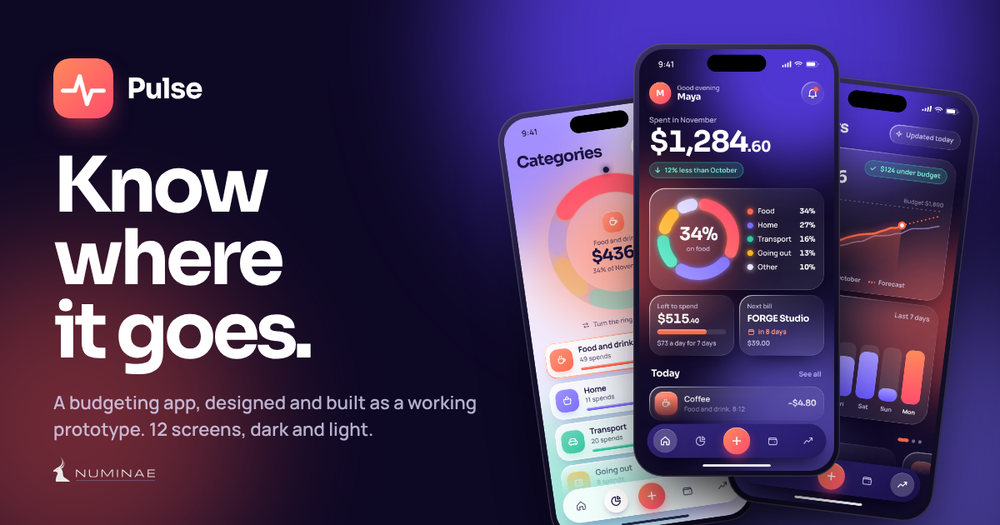

# Pulse · a budgeting app, designed and built

Pulse reads your card and sorts every spend for you. It started as a 10-second ad, and this is the app behind it: twelve screens in dark and light, built as a prototype you can tap through on a phone.

**[Case study](https://numinae.github.io/pulse-app/)** · **[Open the app](https://numinae.github.io/pulse-app/app/)**

<a href="https://numinae.github.io/pulse-app/"></a>

## What's inside

- **The app** (`app/`): intro, link a card, dashboard, categories, transactions, spend detail, budgets, insights, subscriptions and bills, savings goals, cards and accounts, profile. Every screen works in dark and light.
- **Real gestures**: swipe from the left edge to go back, drag panels down to close them, turn the category ring, swipe through cards, add a spend with the keypad.
- **Sample data that adds up**: 96 spends in November, $1,284.60 in total, split across five categories with exact totals.
- **Add to Home Screen**: on a phone, Pulse opens full screen like an installed app.
- **The case study** (`index.html`): the live prototype in a phone frame, all screens, motion notes, the design system, the four style directions and the ad.
- **Style samples** (`style-samples/`): the four directions I drew before building, each live.

Plain HTML, CSS and JavaScript. No frameworks, no build step, no libraries.

## Run it locally

Open the folder with any static server, for example:

```
python -m http.server
```

Then visit `http://localhost:8000/` for the case study or `http://localhost:8000/app/` for the app.

---

Pulse is a concept app. Every name, bank, card and number in it is made up.
Designed and built by [Numinae Studio](https://github.com/NUMINAE) · [@numinaestudio](https://t.me/numinaestudio) on Telegram.
